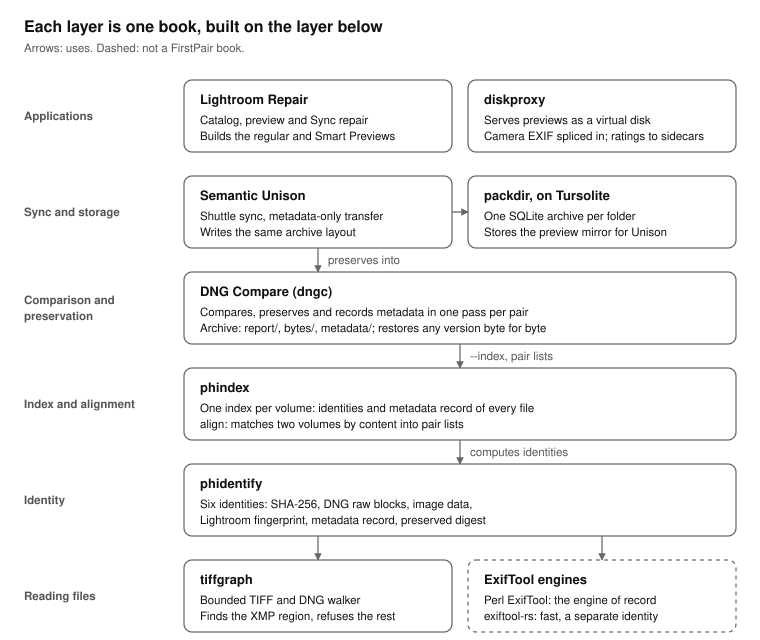

# About this book

This book is by Alexy Khrabrov, with Claude as co-author. The ideas and decisions are Alexy's; Claude wrote the text and much of the code with him.

It is a map. Nine other books on the First Pair shelves each describe one tool for keeping photographs: how to tell copies apart, remember what a volume holds, preserve one copy against another, synchronize, store, serve and repair. This book says how they fit together, walks through them end to end, and points to the book that owns each detail. It describes them as of November 2026. Every example uses synthetic paths such as `/Volumes/Archive`.

# The problem

A photograph rarely exists once. There is the camera's file, a DNG converted from it, a copy on a backup disk, another on a shuttle disk, previews in a catalog, and a cloud original. Over years the copies drift. An editor writes a rating into one. A converter rewrites another. A clock correction shifts every capture time. A copy is interrupted halfway and nobody notices.

Then someone wants to free a disk, and has to answer a question that sounds simple: *is everything on this disk somewhere else?* The usual tools answer badly in both directions.

- **A checksum says "different" too often.** Two DNGs with the same sensor samples and a different rating have different SHA-256 hashes. Deleting by checksum keeps everything.
- **A file name says "same" too easily.** Two files called `IMG_0001.DNG` may be different photographs, or one may be truncated. Deleting by name loses things.
- **A thumbnail can lie.** A DNG's embedded preview sits early in the file. When a copy is cut short, the preview often survives, and the file looks fine in every browser while its raw data is gone.

The tools in this book answer the question properly. They identify photographs by what they contain, remember those identities for whole volumes, account for one volume in another by content, and keep every byte that would otherwise be lost, as a delta against the copy that remains.

# The stack



Read the diagram from the bottom.

**Reading files.** [tiffgraph](https://firstpair.org/books/tiffgraph/) walks the structure of a TIFF or DNG file under a fixed grammar. It finds the one region an editor may rewrite, the XMP packet, and refuses any file outside its grammar with a reason. Beside it sit the ExifTool engines: Perl ExifTool, the engine of record, and exiftool-rs, a faster reimplementation whose records are a separate identity and are never mixed with Perl's.

**Identity.** [phidentify](https://firstpair.org/books/phidentify/) computes seven identities of a file. Whole-file SHA-256 answers "is it the same file?"; DNG raw blocks and image data answer "is it the same photograph?"; block marks, a sampled fingerprint of every large block in the file, answer "is it an edited copy of that file?"; the Lightroom fingerprint answers "is it the original my catalog recorded?"; the metadata record says what an editor changed; and the preserved digest proves that only the XMP packet differs. It also builds a file's *skeleton*: the few kilobytes a metadata edit rewrites, with a map of the large blocks it leaves alone, from which the file as it was can be rebuilt out of its edited copy.

**Index and alignment.** [phindex](https://firstpair.org/books/phindex/) keeps those identities for every file of a volume in one SQLite index, cheap to rerun. `phindex align` accounts for one volume in another by identity, so moved, renamed and re-dated copies are found, and writes pair lists of what matched and how. It keeps a skeleton of every file too, and the earlier contents of a path, so `phindex restore` brings back a file as it was before an editor wrote into it.

**Comparison and preservation.** [DNG Compare](https://firstpair.org/books/dng-compare/) takes those pairs, or a whole tree, and through one command, `dngc`, compares each pair, preserves the source as a verified delta against its counterpart, and records metadata differences in a searchable index. Its archive rebuilds any source file byte for byte, and keeps doing so after the counterparts are edited, moved or renamed.

**Sync and storage.** [Semantic Unison](https://firstpair.org/books/semantic-unison/) synchronizes photo trees, sending a metadata edit without resending image bytes, keeps the versions it replaces as skeletons of a few kilobytes each, and preserves what a shuttle disk brings into the same kind of archive. [packdir](https://firstpair.org/books/packdir/) keeps directories of many small files, such as a preview cache, as SQLite archives that still work like plain files. Both store their databases through [Tursolite](https://firstpair.org/books/tursolite/), one interface over SQLite and Turso.

**Applications.** [Lightroom Repair](https://firstpair.org/books/lightroom-repair/) repairs Lightroom Classic catalogs, previews and Sync without forging their state. [diskproxy](https://firstpair.org/books/diskproxy/) serves a folder as a virtual disk, so previews can be browsed and rated with the originals offline, with camera metadata spliced in and ratings captured into sidecars.

# One volume accounted for in another

This walk takes a source volume, `/Volumes/Archive/Photos`, and proves that a backup, `/Volumes/Backup/Photos`, holds everything on it, or keeps what it does not. Each step names the book that describes it fully.

1. **Index both volumes** (phindex). One read of every file, once; later runs read only what changed.

    ```sh
    phindex --db archive.sqlite --root /Volumes/Archive/Photos
    phindex --db backup.sqlite  --root /Volumes/Backup/Photos
    ```

2. **Align them** (phindex). Every source file gets a tier: `identical` (same bytes), `dng-metadata` or `image-metadata` (same photograph, metadata differs), `xmp-only`, `lightroom`, `unit-partner`, or `unmatched`.

    ```sh
    phindex align --left archive.sqlite --left-root /Volumes/Archive/Photos \
                  --right backup.sqlite --right-root /Volumes/Backup/Photos --out align/
    ```

3. **Preserve the whole source** (DNG Compare). Identical files become reference records without being read; the rest become verified deltas against their counterparts; unmatched files become full copies. Metadata comes from the indexes.

    ```sh
    dngc run /Volumes/Archive/Photos /Volumes/Backup/Photos /Volumes/Backup/dngc/Archive \
         --index archive.sqlite backup.sqlite --metadata phindex
    ```

4. **Verify** (DNG Compare). Rebuild a sample from the archive and check every hash.

    ```sh
    dngc verify /Volumes/Backup/dngc/Archive --restore-sample 50
    dngc query  /Volumes/Backup/dngc/Archive              # what metadata differed, most often first
    ```

5. **Make the backup safe to edit** (DNG Compare). The archive's deltas and identical records lean on the backup's files as they are now, and the backup is a library someone will keep working in. One pass stores a skeleton of each of those files in the archive.

    ```sh
    dngc skeleton build /Volumes/Backup/dngc/Archive
    ```

Only now may the source volume be freed, and only together with the archive and the backup it refers to. Any file comes back with `dngc restore`. After the skeleton pass the backup can go on being used: a rating, a caption or a develop setting written into one of its files no longer breaks the records that name it, because the archive rebuilds the file as it was from the edited one. If the backup is later moved to another disk, `dngc restore --reference-root` reads it there, and `--index` finds files that were renamed.

On one real pair of volumes, 1.7 million source files, the skeleton pass took twelve hours and stored 1.47 million skeletons in 17 GB, about 11 KB each, and all of a sample of 1,000 rebuilt their files exactly. The walk as a whole accounted for 1.2 million identical files without reading them, 480,000 DNGs whose raw samples matched but whose bytes did not, and 5,600 files with no copy at all. It also found 77 originals that had been truncated long ago while an intact converted copy existed elsewhere: the case where deleting by thumbnail would have kept the broken files.

# The archive

Everything the walk above keeps ends up in one directory, a `dngc` archive. [DNG Compare](https://firstpair.org/books/dng-compare/) owns the format and describes it in full (its Part II); [Semantic Unison](https://firstpair.org/books/semantic-unison/) writes the same layout when it preserves what a shuttle disk brings. This is its shape.

```text
ARCHIVE/
  ARCHIVE.json          every run: options, sources, implementation, exit statuses
  MIGRATION.jsonl       each step of a migration from an older layout
  report/               the comparison
    pairs.jsonl           one result per pair: raw equal or not, metadata changes
    summary.json
    cache.sqlite3         what a repeated run reuses
  bytes/                the preservation: what rebuilds every source file
    recovery.sqlite3      one record per source file, earlier versions, errors
    deltas/               VCDIFF deltas against the reference copies
    originals/            full copies of files with no counterpart
    versions/LABEL/       payloads of earlier contents of a refilled path
  metadata/             the searchable metadata
    batches/*.jsonl.gz    each file's metadata record on both sides of its pair
    differences.sqlite3   one row per changed tag per file, for SQL queries
    summary.json, provenance.json
  skeletons/            what keeps the archive restorable after the reference is edited
    skeletons.sqlite3     one skeleton per reference content
  trash/DROP/           payloads of records dngc drop moved to the trash
```

**Every source file has one record, of one of three kinds.**

- **Identical**: the reference holds the same bytes. The record keeps both SHA-256s, both identities (inode, size, modification and change time) and the file's attributes, and no payload.
- **Delta**: the reference differs. The record names a delta that rebuilds the source from the reference; the delta was decoded again and checked against the source's SHA-256 before it counted.
- **Full copy**: the source has no counterpart, so the file itself is kept under `originals/`.

`dngc restore` needs only a record, the payload it names, and for an identical or delta record the reference's content; it checks the rebuilt file's SHA-256 and restores its mode, times, flags and extended attributes.

**A reference is a content, not a path.** A record names its reference by SHA-256 and remembers where that content was last seen. `restore` looks for it at that path, or below `--reference-root` when the tree has moved; then in any file a phindex index (`--index`) lists with the same SHA-256; and, when the file has been edited, it rebuilds the content from the archive's skeleton and the edited file, which it can also find through an index by its image data. Whatever it finds is checked by SHA-256 before it is used. A skeleton cannot bring back a block the edit itself destroyed, such as a regenerated embedded preview or changed pixels; `dngc keep` is for files that must not depend on a reference at all. Records name payloads relative to `bytes/`, so the archive can be moved as a whole.

**The metadata section is evidence, not a backup.** It holds what an editor changed, tag by tag, so a question such as "which files lost their rating" is one query. It never rebuilds a file; the byte section does. A pair whose two files have the same SHA-256 keeps only that hash, since its metadata cannot differ, and a file of a type the metadata engine does not read, such as an editor's cache file, is listed as having no metadata rather than as an error. Records of Perl ExifTool and of exiftool-rs are separate identities and never mixed in one archive.

**What the format guarantees.**

- **Nothing is overwritten.** A path whose content changes between runs keeps every content it had, each under a version label; `dngc versions` lists them.
- **Nothing is removed unless asked.** A run never deletes a record. `dngc drop` does, in two stages: to the archive's trash first, from which `dngc trash restore` brings it back, and for good only with `--force` or `trash empty`.
- **A reference may be edited, moved or renamed.** Once its skeleton is in the archive, a metadata edit to a reference file leaves every record that names it restorable, and a moved or renamed one is found again by content.
- **A missing source is not an error in the archive.** An emptied shuttle disk leaves its earlier records as they were.
- **Reading changes nothing.** `status`, `verify`, `query`, `versions` and `restore` open the databases so that no `-wal` or `-shm` file appears, and need no source.
- **Damage is preserved, not repaired.** A damaged source is kept damaged, byte for byte; finding damage is the comparison's job.

**Listing and pruning.** `dngc ls` prints the records a pattern, a kind or a changed metadata tag selects, one per line or NUL-separated for `xargs -0`, as relative, source or reference paths. `dngc drop` removes records and leaves a tombstone, so later runs do not preserve those files again. `dngc keep` turns records that depend on a reference copy into full copies, so the reference can be deleted without loss; deleting a reference file under an identical or delta record would otherwise leave that record unrestorable, since a skeleton covers an edit, not a deletion. DNG Compare's chapter on these commands has the details and examples.

An archive written before this layout kept its byte section at the top; `dngc migrate` moves it into `bytes/`, logging every step to `MIGRATION.jsonl` first, so an interrupted migration resumes and `--undo` reverses it.

# A shuttle disk, through Semantic Unison

A shuttle disk carries new photographs from a laptop to the archive. [Semantic Unison](https://firstpair.org/books/semantic-unison/) synchronizes it with the archive's tree. When only metadata changed, it sends the XMP packet, not the image, and checks with the preserved digest that nothing else moved. Before the shuttle is emptied, Unison preserves what it brought into a DNG Compare archive with the same layout, so a refilled path later gets a new *version* rather than overwriting the old one. `dngc versions` lists them and `dngc restore --version` rebuilds any of them. On either replica, Unison can also keep the last few versions of each file it replaces as skeleton versions, a few kilobytes for the first and a few hundred bytes for each one after, which `unison-skeleton` lists and restores.

# Working without the originals

Previews are small, and originals are large and often offline. Two paths make previews useful on their own.

- **Lightroom's previews.** Lightroom Classic builds regular previews and Smart Previews. [Lightroom Repair](https://firstpair.org/books/lightroom-repair/) describes building and verifying them without disturbing the catalog.
- **Serving them as a library.** [diskproxy](https://firstpair.org/books/diskproxy/) presents a folder as a virtual disk without writing it. Its previews plugin serves Smart Previews as DNG stand-ins with a large preview added, or preview JPEGs with camera EXIF spliced in from small stubs; the stubs can be written from phindex's metadata records and kept in one SQLite store. An application such as Photo Mechanic then shows camera, lens, exposure and GPS for every preview. On a writable view, ratings, labels and flags it writes are captured as small XMP sidecars with a journal, and the source is never touched.

Bringing those ratings back into a Lightroom catalog has to go through Lightroom's own writer; Lightroom Repair says what is and is not qualified for that.

# Which tool answers which question

| Question | Start with | Book |
| --- | --- | --- |
| Is this file in my backup? | SHA-256, then raw blocks or image data, from the indexes | phindex, phidentify |
| Was this only a metadata edit? | the preserved digest and the metadata diff | phidentify |
| What changed in the metadata, across a whole archive? | `dngc query` | DNG Compare |
| Can I delete this copy? | `dngc run`, then `dngc verify` | DNG Compare |
| Can I keep editing the library my archive refers to? | `dngc skeleton build`, once per run | DNG Compare |
| The library moved or files were renamed; can I still restore? | `dngc restore --reference-root`, or `--index` with a phindex index | DNG Compare, phindex |
| What did this file look like before the last edits? | `phindex restore`; `unison-skeleton restore` on a synchronized tree | phindex, Semantic Unison |
| Did the shuttle copy arrive intact? | SHA-256; the preserved digest if metadata was written on arrival | phidentify, Semantic Unison |
| Is this still the original my catalog recorded? | the Lightroom fingerprint | phidentify, Lightroom Repair |
| Can I browse and rate with the originals offline? | diskproxy's previews plugin | diskproxy |
| How do I keep a million small files on a backup disk? | packdir | packdir |

# Who owns what

Each contract is explained in full in one book. The others give it a sentence and a link.

| Contract | Owning book |
| --- | --- |
| The identities and what equality proves; block marks | phidentify |
| How a file is cut into blocks and a skeleton | DNG Compare (its archive format), followed by phidentify and Semantic Unison |
| Index schema, align tiers, pair files, stored skeletons and earlier contents | phindex |
| Archive layout, byte-section rule, versions, the skeleton section, the engine rule | DNG Compare |
| DNG profiles, `SDE/0-preserved`, the shuttle cycle, skeleton versions | Semantic Unison |
| Grammars and refusals for the XMP region | tiffgraph |
| Container format and clones | packdir |
| Engines, journals, sealing and the Turso rules | Tursolite |
| Map file, metadata splicing, ratings capture | diskproxy |
| Catalog, preview and Sync procedures | Lightroom Repair |

## Where it fits

This book is one of nine on the FirstPair photo tools. Each owns one part, and
[The FirstPair Photo Stack](https://firstpair.org/books/photostack/) shows how they fit together.

- **[tiffgraph](https://firstpair.org/books/tiffgraph/)** walks a TIFF or DNG file's structure under a fixed grammar and finds its editable XMP packet.
- **[phidentify](https://firstpair.org/books/phidentify/)** computes a photo's identities: SHA-256, DNG raw blocks, image data, block marks, Lightroom fingerprint, metadata record and preserved digest, and the skeleton that rebuilds a file from an edited copy.
- **[phindex](https://firstpair.org/books/phindex/)** keeps those identities and a skeleton for every file of a volume, aligns two volumes by content, and restores a file as it was before a metadata edit.
- **[DNG Compare](https://firstpair.org/books/dng-compare/)** compares pairs and preserves one side byte for byte as deltas against the other, restorable even after the other side is edited, with a searchable metadata section, through `dngc`.
- **[Semantic Unison](https://firstpair.org/books/semantic-unison/)** synchronizes photo trees, sending metadata edits without resending image bytes, keeps the versions it replaces as small skeletons, and preserves what a shuttle disk brings into the same archives.
- **[packdir](https://firstpair.org/books/packdir/)** keeps directories of small files as SQLite archives that still work like plain files.
- **[Tursolite](https://firstpair.org/books/tursolite/)** is the SQLite and Turso layer under packdir, DNG Compare and Mechanic.
- **[diskproxy](https://firstpair.org/books/diskproxy/)** serves a folder as a virtual disk, such as previews with camera metadata spliced in, and captures ratings into sidecars.
- **[Lightroom Repair](https://firstpair.org/books/lightroom-repair/)** repairs Lightroom Classic catalogs, previews and Sync without forging their state.

The block above is the one every book carries word for word. Its source is `where-it-fits.md` in this book's repository, and `scripts/check-where-it-fits.py` checks a book's copy against it.
